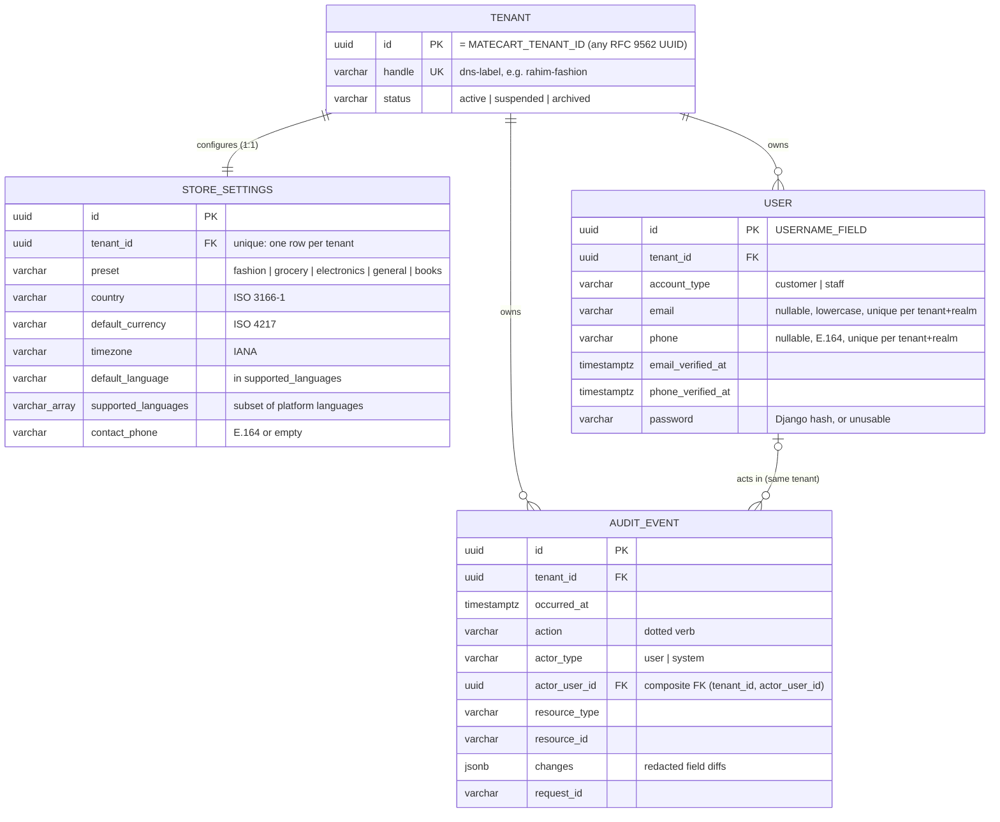

# Data model

The database architecture of MateCart: conventions every table follows, the schema implemented so far, and the blueprint later phases build on. Reasoning for each choice is in [DECISIONS.md](DECISIONS.md) (D-023 to D-033). Isolation mechanics are in [ARCHITECTURE.md §3](ARCHITECTURE.md#3-deployment-and-tenancy-model).

## 1. Conventions

| Topic              | Rule                                                                                                                                                                                                                                                                                                                                                                                                                                       |
| ------------------ | ------------------------------------------------------------------------------------------------------------------------------------------------------------------------------------------------------------------------------------------------------------------------------------------------------------------------------------------------------------------------------------------------------------------------------------------ |
| Primary keys       | Keys MateCart generates are UUIDv7 (`UUIDModel` default): globally unique, not enumerable, time-ordered. **Externally assigned ids** (`Tenant.id` = `MATECART_TENANT_ID`, future console store registration ids) may be any RFC 9562 UUID version; nil and max are rejected; new ones are generated as UUIDv7 (D-036). Human-friendly numbers (order `#MC-24871`, invoice numbers) are separate per-tenant sequences added by their phase. |
| Timestamps         | `created_at`, `updated_at` (`TimestampedModel`) on mutable business tables. Append-only tables use one domain timestamp (for example `occurred_at`). `QuerySet.update()` does not touch `updated_at`; set it explicitly.                                                                                                                                                                                                                   |
| Tenant ownership   | Every business table extends `TenantOwnedModel`: non-null `tenant` FK (`PROTECT`), unique `(tenant, id)`, scoped `objects` manager, and tenant-qualified SQL for every update, delete and refresh of an existing row (D-034). See §3 of ARCHITECTURE.                                                                                                                                                                                      |
| Foreign keys       | Between tenant-owned tables: ordinary FK **plus** `TenantForeignKeyConstraint` (composite `(tenant_id, x_id)` FK enforced by PostgreSQL). `on_delete` is chosen per relation; history-bearing rows use `PROTECT`.                                                                                                                                                                                                                          |
| Uniqueness         | Business keys are unique **per tenant**, for example `(tenant, sku)` or `(tenant, account_type, email)`. Never globally, so stores never collide and can later share a database.                                                                                                                                                                                                                                                           |
| Indexes            | Composite indexes start with `tenant_id`. The `(tenant, id)` unique index replaces a separate `tenant_id` index. Add indexes for real query patterns, not speculatively.                                                                                                                                                                                                                                                                   |
| Choices            | `TextChoices` in code **and** a `CHECK (col IN (...))` constraint in the database.                                                                                                                                                                                                                                                                                                                                                         |
| Absent values      | `NULL` means "not provided" when uniqueness must ignore absence (email, phone). Otherwise text columns use `''`.                                                                                                                                                                                                                                                                                                                           |
| JSON               | Only for genuinely schemaless data: audit `changes`, provider payload snapshots, translated content maps. Never for data that is queried, joined or constrained.                                                                                                                                                                                                                                                                           |
| Money              | `DecimalField(max_digits=19, decimal_places=4)` plus an ISO 4217 `currency` column; never float. Rounding to the currency's minor unit happens at defined calculation boundaries (Phase 07). Babel provides minor-unit precision per currency.                                                                                                                                                                                             |
| International data | Countries: ISO 3166-1 alpha-2. Currencies: ISO 4217. Time zones: IANA names. Phones: E.164. Languages: BCP 47 tags from `PLATFORM_LANGUAGES`. Times are stored in UTC and shown in the store's time zone. No market-specific columns.                                                                                                                                                                                                      |
| Deletion           | No global soft-delete flag. Lifecycle is explicit per model (`status`, `is_active`, `archived_at`). Rows with history (orders, payments, audit) are never hard-deleted. Personal-data erasure anonymises identities instead of deleting them (Phase 10/18).                                                                                                                                                                                |
| Audit              | Important changes write an `AuditEvent` in the same transaction (`record_audit_event`). Payloads list their fields explicitly (`field_changes(..., fields=...)`) and are sanitised recursively: secrets are redacted at any depth, unsupported objects become type markers, contact details are not recorded unless an audit need is documented (D-035). Audit rows are append-only (ORM and PostgreSQL trigger).                          |
| Migrations         | Generated by `makemigrations`, reviewed with `sqlmigrate`, verified forward and backward on a temporary database. Hand-written SQL only via `RunSQL` with `reverse_sql`. Never `--fake`, never resets.                                                                                                                                                                                                                                     |

## 2. Implemented schema (Phase 02)

### commerce-api (one database per store deployment)

Database constraints, all enforced by PostgreSQL and covered by tests:

| Table                  | Constraints                                                                                                                                                                                                                                                                       |
| ---------------------- | --------------------------------------------------------------------------------------------------------------------------------------------------------------------------------------------------------------------------------------------------------------------------------- |
| `tenancy_tenant`       | handle unique and DNS-label format; status in allowed set                                                                                                                                                                                                                         |
| `stores_storesettings` | one row per tenant; `(tenant, id)` unique; preset in set; country `^[A-Z]{2}$`; currency `^[A-Z]{3}$`; default language ∈ supported languages; supported languages non-empty and ⊆ platform languages; contact phone E.164 or empty                                               |
| `identity_user`        | `(tenant, id)` unique; email unique per `(tenant, account_type)` when present; phone unique per `(tenant, account_type)` when present; at least one of email/phone; email lowercase and non-empty; phone E.164; account type in set; a verified timestamp requires the identifier |
| `audit_auditevent`     | `(tenant, id)` unique; composite FK `(tenant_id, actor_user_id)` → `identity_user (tenant_id, id)`; action format; actor type consistent with actor; **UPDATE and DELETE refused by trigger**                                                                                     |

Django's own `auth_group`, `auth_permission` and related tables exist because `django.contrib.auth` is installed, but they are global (not tenant-scoped) and are **not used** for store roles (D-027).

### control-api (NetaMate's own database)

| Table                | Purpose                                                                                                                                         |
| -------------------- | ----------------------------------------------------------------------------------------------------------------------------------------------- |
| `accounts_adminuser` | NetaMate console administrators: UUIDv7 id, email unique and lowercase (`CHECK`), password hash, `is_active`. `AUTH_USER_MODEL` of control-api. |

There are no tenant tables, no store data and no foreign keys to the commerce database (verified by test).

## 3. Identity model

| Concept                   | Where it lives                                         | Notes                                                                                          |
| ------------------------- | ------------------------------------------------------ | ---------------------------------------------------------------------------------------------- |
| NetaMate administrator    | control-api `accounts.AdminUser`                       | Global email identity; console only; MFA mandatory from Phase 03/16.                           |
| NetaMate client (company) | control-api, Phase 16                                  | Commercial relationship; not a login.                                                          |
| Store registration        | control-api, Phase 16                                  | Its id **is** the commerce tenant id (`MATECART_TENANT_ID`), the only cross-service reference. |
| Production deployment     | control-api, Phases 16–17                              | Where and which version a store runs.                                                          |
| Commerce tenant           | commerce-api `tenancy.Tenant`                          | Ownership boundary inside the store's database.                                                |
| Customer account          | commerce-api `identity.User` (`account_type=customer`) | Per store. The same person shopping at two stores has two unrelated accounts.                  |
| Merchant staff account    | commerce-api `identity.User` (`account_type=staff`)    | Per store. Roles and permissions in Phase 03 (tenant-scoped, not Django groups).               |

Login identifiers: email and phone are both optional, at least one is required, normalised (lowercase; E.164) and unique per tenant and realm. Phase 03 can therefore offer email + password, phone + OTP, or both, without changing the table. `USERNAME_FIELD` is the opaque `id`; login backends resolve identifiers within the active tenant and realm. Until Phase 03, `NoLoginBackend` refuses every sign-in.

## 4. Domain blueprint (later phases)

Every table below is tenant-owned unless marked otherwise. Arrows are FKs and carry `TenantForeignKeyConstraint`. "UK" lists per-tenant uniqueness.

| Area (phase)                        | Tables and key relationships                                                                                                                                                                                                                                                                     | UK and notes                                                                                                                                |
| ----------------------------------- | ------------------------------------------------------------------------------------------------------------------------------------------------------------------------------------------------------------------------------------------------------------------------------------------------ | ------------------------------------------------------------------------------------------------------------------------------------------- |
| **Store configuration** (05, 17)    | `StoreModule` (key, enabled, config) · `StoreTheme` (preset tokens, branding assets) · `StoreDomain` (hostname, verified_at, is_primary)                                                                                                                                                         | UK `(tenant, module)`, `(tenant, hostname)`; hostnames also globally unique for routing. Module catalogue and preset defaults live in code. |
| **Staff and access** (03)           | `StaffMembership` → User(staff) · `Role` · `RolePermission` · `MembershipRole`                                                                                                                                                                                                                   | UK `(tenant, user)`, `(tenant, role.name)`. Tenant-scoped RBAC; owner role protected.                                                       |
| **Customers** (03, 10)              | `CustomerProfile` → User(customer) · `Address` → User · `ConsentRecord` → User                                                                                                                                                                                                                   | Addresses use ISO country and free-form lines (international); consent records are append-only.                                             |
| **Catalogue** (04)                  | `Category` (tree) · `Collection` · `Product` · `ProductVariant` → Product · `ProductAttribute` / `AttributeValue` (typed, preset-driven) · `ProductMedia` → MediaAsset · `BookDetails` → Product (ISBN, author, publisher, edition, format, pages, series) · `ElectronicsSpec`, `WarrantyPolicy` | UK `(tenant, slug)`, `(tenant, sku)`, `(tenant, isbn)`. Preset data in typed tables or attribute tables, not free JSON.                     |
| **Inventory** (04, 08)              | `StockLocation` · `StockLevel` → Variant, Location · `StockMovement` (append-only ledger: receipt, sale, return, adjustment, reservation) · `Batch` (expiry, for grocery) · `SerialNumber` (electronics)                                                                                         | UK `(tenant, variant, location)`. Levels derived from movements; reservations prevent overselling (row locks or conditional updates).       |
| **Pricing and promotions** (04, 12) | `PriceList` · `Price` → Variant · `Coupon` · `CouponRedemption` → Coupon, Order · `Campaign` · `FlashSale` · `LoyaltyAccount` / `LoyaltyLedger`                                                                                                                                                  | UK `(tenant, coupon.code)`. Money convention §1. Redemptions are idempotent per order.                                                      |
| **Cart and checkout** (07)          | `Cart` → User? (guest token) · `CartItem` → Cart, Variant · `CheckoutSession` (idempotency key)                                                                                                                                                                                                  | UK `(tenant, idempotency_key)`. Carts expire; price snapshot at checkout.                                                                   |
| **Orders** (08)                     | `Order` (number, state machine, totals, currency) · `OrderItem` (price and product snapshot) · `OrderStatusEvent` (append-only) · `Invoice` (number, QR)                                                                                                                                         | UK `(tenant, order.number)`, `(tenant, invoice.number)`. Orders keep snapshots, never live product references only.                         |
| **Payments and refunds** (08)       | `PaymentIntent` → Order · `PaymentTransaction` (provider, provider_ref, status, raw payload JSON) · `Refund` → Transaction · `ProviderCallback` (idempotent webhook log)                                                                                                                         | UK `(tenant, provider, provider_ref)`. No card data stored. Callbacks verified and deduplicated.                                            |
| **Fulfilment and couriers** (09)    | `Shipment` → Order · `ShipmentItem` · `CourierBooking` (provider, tracking_no) · `TrackingEvent` (append-only) · `CodSettlement` · `FraudAssessment` → Order                                                                                                                                     | UK `(tenant, courier, tracking_no)`. Courier credentials live in `IntegrationCredential`.                                                   |
| **After-sales** (10)                | `Review` → Product, User · `ReturnRequest` → Order · `ReturnItem` · `Exchange` · `WarrantyClaim` · `DigitalEntitlement` → OrderItem, MediaAsset                                                                                                                                                  | One review per (user, product). Digital downloads via signed, expiring URLs.                                                                |
| **Notifications** (13)              | `NotificationTemplate` · `Notification` (channel, recipient, status, attempts) · `DeliveryAttempt` (append-only) · `MailConnection` (SMTP/IMAP or MateMail)                                                                                                                                      | UK `(tenant, template.key, locale)`. Deduplication key per event.                                                                           |
| **Communications** (14)             | `Conversation` (channel) · `Message` · `ChannelConnection`                                                                                                                                                                                                                                       | Provider ids unique per tenant and channel.                                                                                                 |
| **Media** (04+)                     | `MediaAsset` (storage path via `tenant_storage_path`, mime, size, checksum)                                                                                                                                                                                                                      | Paths namespaced `tenants/<id>/...`; files never shared across tenants.                                                                     |
| **Integrations** (08, 09, 12–15)    | `IntegrationConnection` (provider, status) · `IntegrationCredential` (encrypted secret, key version)                                                                                                                                                                                             | Secrets encrypted at rest with a per-deployment key; never logged, never in audit `changes`.                                                |
| **Analytics** (12)                  | `VisitorDailyStat` (rolling 24-hour and daily aggregates) · `EventCounter`                                                                                                                                                                                                                       | Aggregates only; raw tracking respects consent.                                                                                             |
| **Audit** (02, ongoing)             | `AuditEvent` (implemented)                                                                                                                                                                                                                                                                       | Every phase adds its own `action` names (for example `order.cancelled`).                                                                    |

### Control-plane blueprint (Phase 16, control-api database)

| Table                             | Purpose and key relationships                                                                                         |
| --------------------------------- | --------------------------------------------------------------------------------------------------------------------- |
| `Client`                          | NetaMate's customer company (contract, contacts, billing references kept outside MateCart while billing is deferred). |
| `StoreRegistration`               | `id` = commerce `MATECART_TENANT_ID`, handle, preset, plan/modules, owning `Client`.                                  |
| `Server`                          | Host inventory: provider, region, capacity, owner (NetaMate or client VPS).                                           |
| `Deployment`                      | StoreRegistration on a Server: release version, status, domain, last health.                                          |
| `Release`                         | Versioned commerce release (image digests, migration notes).                                                          |
| `FeatureConfiguration`            | Module availability per store registration, pushed to the store (the store keeps working without the console).        |
| `HealthSnapshot` / `MetricRollup` | Aggregated operational metrics (rolling 24-hour visitors, error rates). No customer personal data.                    |
| `AdminRole`, `ConsoleAuditEvent`  | Console RBAC and its own append-only audit log.                                                                       |

Cross-service references use opaque UUIDs only. There are no foreign keys between the two databases, and a store never needs the console to serve customers.

## 5. Path to a shared (pooled) database

The schema already supports moving stores into one database without re-keying, because primary keys are UUIDv7, every business row carries `tenant_id`, uniqueness is per tenant, and cross-row references are tenant-guarded. What a pooled mode would still need, as a separate decision (D-026): verified domain-to-tenant resolution, PostgreSQL row-level security as defence in depth, per-tenant rate limits and quotas, and tenant-aware search and analytics stores.
