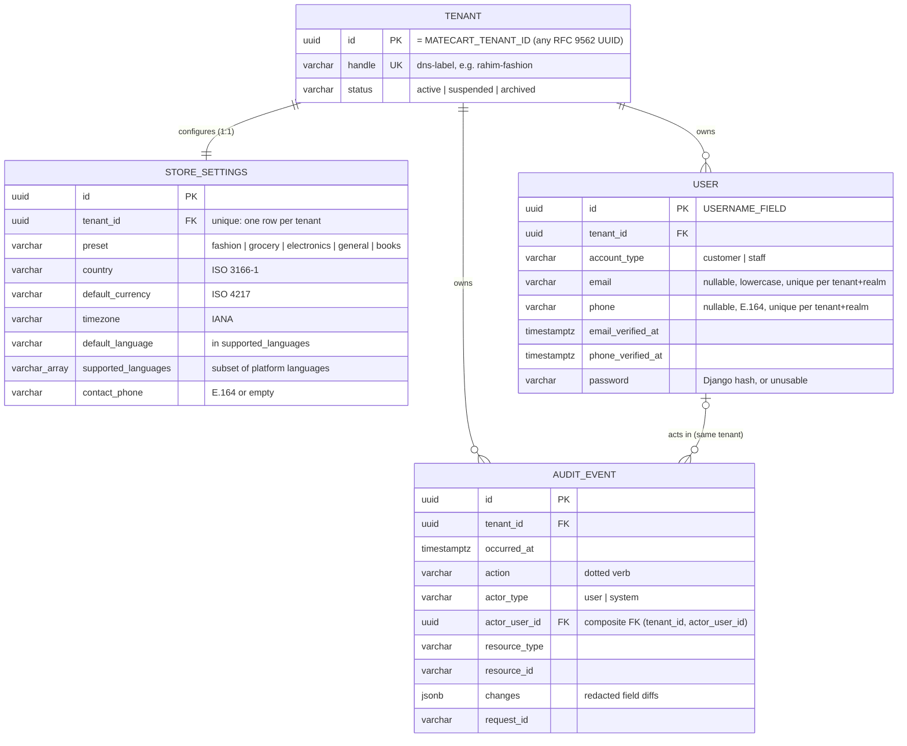
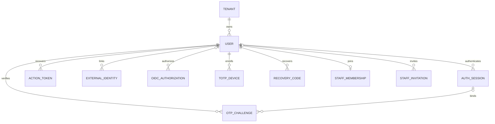
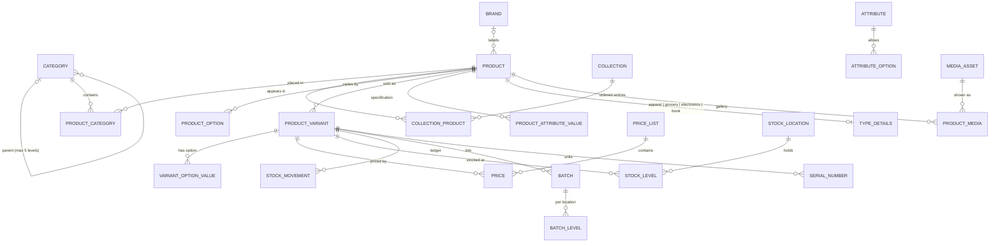

# Data model

The database architecture of MateCart: conventions every table follows, the schema implemented so far, and the blueprint later phases build on. Reasoning for each choice is in [DECISIONS.md](DECISIONS.md) (D-023 to D-033). Isolation mechanics are in [ARCHITECTURE.md §3](ARCHITECTURE.md#3-deployment-and-tenancy-model).

## 1. Conventions

| Topic              | Rule                                                                                                                                                                                                                                                                                                                                                                                                                                       |
| ------------------ | ------------------------------------------------------------------------------------------------------------------------------------------------------------------------------------------------------------------------------------------------------------------------------------------------------------------------------------------------------------------------------------------------------------------------------------------ |
| Primary keys       | Keys MateCart generates are UUIDv7 (`UUIDModel` default): globally unique, not enumerable, time-ordered. **Externally assigned ids** (`Tenant.id` = `MATECART_TENANT_ID`, future console store registration ids) may be any RFC 9562 UUID version; nil and max are rejected; new ones are generated as UUIDv7 (D-036). Human-friendly numbers (order `#MC-24871`, invoice numbers) are separate per-tenant sequences added by their phase. |
| Timestamps         | `created_at`, `updated_at` (`TimestampedModel`) on mutable business tables. Append-only tables use one domain timestamp (for example `occurred_at`). `QuerySet.update()` does not touch `updated_at`; set it explicitly.                                                                                                                                                                                                                   |
| Tenant ownership   | Every business table extends `TenantOwnedModel`: non-null `tenant` FK (`PROTECT`), unique `(tenant, id)`, scoped `objects` manager that is also the base manager (`Meta.base_manager_name`), tenant-qualified SQL for every update and delete of an existing row (D-034), and reads governed by the active tenant (D-038). See §3 of ARCHITECTURE.                                                                                         |
| Foreign keys       | Between tenant-owned tables: ordinary FK **plus** `TenantForeignKeyConstraint` (composite `(tenant_id, x_id)` FK enforced by PostgreSQL). `on_delete` is chosen per relation; history-bearing rows use `PROTECT`.                                                                                                                                                                                                                          |
| Uniqueness         | Business keys are unique **per tenant**, for example `(tenant, sku)` or `(tenant, account_type, email)`. Never globally, so stores never collide and can later share a database.                                                                                                                                                                                                                                                           |
| Indexes            | Composite indexes start with `tenant_id`. The `(tenant, id)` unique index replaces a separate `tenant_id` index. Add indexes for real query patterns, not speculatively.                                                                                                                                                                                                                                                                   |
| Choices            | `TextChoices` in code **and** a `CHECK (col IN (...))` constraint in the database.                                                                                                                                                                                                                                                                                                                                                         |
| Absent values      | `NULL` means "not provided" when uniqueness must ignore absence (email, phone). Otherwise text columns use `''`.                                                                                                                                                                                                                                                                                                                           |
| JSON               | Only for genuinely schemaless data: audit `changes`, provider payload snapshots, translated content maps. Never for data that is queried, joined or constrained.                                                                                                                                                                                                                                                                           |
| Money              | `DecimalField(max_digits=19, decimal_places=4)` plus an ISO 4217 `currency` column; never float. Rounding to the currency's minor unit happens at defined calculation boundaries (Phase 07). Babel provides minor-unit precision per currency.                                                                                                                                                                                             |
| International data | Countries: ISO 3166-1 alpha-2. Currencies: ISO 4217. Time zones: IANA names. Phones: E.164. Languages: BCP 47 tags from `PLATFORM_LANGUAGES`. Times are stored in UTC and shown in the store's time zone. No market-specific columns.                                                                                                                                                                                                      |
| Deletion           | No global soft-delete flag. Lifecycle is explicit per model (`status`, `is_active`, `archived_at`). Rows with history (orders, payments, audit) are never hard-deleted. Personal-data erasure anonymises identities instead of deleting them (Phase 10/18).                                                                                                                                                                                |
| Audit              | Important changes write an `AuditEvent` in the same transaction (`record_audit_event`). Payloads list their fields explicitly (`field_changes(..., fields=...)`) and are sanitised recursively: secrets are redacted at any depth, unsupported objects become type markers, contact details are not recorded unless an audit need is documented (D-035). Audit rows are append-only (ORM and PostgreSQL trigger).                          |
| Migrations         | Generated by `makemigrations`, reviewed with `sqlmigrate`, verified forward and backward on a temporary database. Hand-written SQL only via `RunSQL` with `reverse_sql`. Never `--fake`, never resets. State-only migrations (for example `AlterModelOptions`) are expected when model options such as `base_manager_name` change; `sqlmigrate` shows them as no-ops.                                                                      |

## 2. Implemented schema (Phases 02–04)

### commerce-api (one database per store deployment)

Database constraints, all enforced by PostgreSQL and covered by tests:

| Table                  | Constraints                                                                                                                                                                                                                                                                       |
| ---------------------- | --------------------------------------------------------------------------------------------------------------------------------------------------------------------------------------------------------------------------------------------------------------------------------- |
| `tenancy_tenant`       | handle unique and DNS-label format; status in allowed set                                                                                                                                                                                                                         |
| `stores_storesettings` | one row per tenant; `(tenant, id)` unique; preset in set; country `^[A-Z]{2}$`; currency `^[A-Z]{3}$`; default language ∈ supported languages; supported languages non-empty and ⊆ platform languages; contact phone E.164 or empty                                               |
| `identity_user`        | `(tenant, id)` unique; email unique per `(tenant, account_type)` when present; phone unique per `(tenant, account_type)` when present; at least one of email/phone; email lowercase and non-empty; phone E.164; account type in set; a verified timestamp requires the identifier |
| `audit_auditevent`     | `(tenant, id)` unique; composite FK `(tenant_id, actor_user_id)` → `identity_user (tenant_id, id)`; action format; actor type consistent with actor; **UPDATE and DELETE refused by trigger**                                                                                     |

Django's own `auth_group`, `auth_permission` and related tables exist because `django.contrib.auth` is installed, but they are global (not tenant-scoped) and are **not used** for store roles (D-027).

### control-api (NetaMate's own database)

| Table                | Purpose                                                                                                                                         |
| -------------------- | ----------------------------------------------------------------------------------------------------------------------------------------------- |
| `accounts_adminuser` | NetaMate console administrators: UUIDv7 id, email unique and lowercase (`CHECK`), password hash, `is_active`. `AUTH_USER_MODEL` of control-api. |

There are no tenant tables, no store data and no foreign keys to the commerce database (verified by test).

## 3. Identity model

| Concept                   | Where it lives                                         | Notes                                                                                          |
| ------------------------- | ------------------------------------------------------ | ---------------------------------------------------------------------------------------------- |
| NetaMate administrator    | control-api `accounts.AdminUser`                       | Global email identity; console only; MFA mandatory from Phase 03/16.                           |
| NetaMate client (company) | control-api, Phase 16                                  | Commercial relationship; not a login.                                                          |
| Store registration        | control-api, Phase 16                                  | Its id **is** the commerce tenant id (`MATECART_TENANT_ID`), the only cross-service reference. |
| Production deployment     | control-api, Phases 16–17                              | Where and which version a store runs.                                                          |
| Commerce tenant           | commerce-api `tenancy.Tenant`                          | Ownership boundary inside the store's database.                                                |
| Customer account          | commerce-api `identity.User` (`account_type=customer`) | Per store. The same person shopping at two stores has two unrelated accounts.                  |
| Merchant staff account    | commerce-api `identity.User` (`account_type=staff`)    | Per store. Roles and permissions in Phase 03 (tenant-scoped, not Django groups).               |

Login identifiers are optional individually, at least one is required, normalised (lowercase; E.164), and unique per tenant and realm. Email/password, phone-only OTP and Google OIDC are implemented paths. `USERNAME_FIELD` stays the opaque `id`; explicit realm services resolve verified login methods. `NoLoginBackend` continues to refuse generic Django login. MFA and account linking never turn a customer into staff.

### Phase 03 authentication schema

All nine new commerce models inherit the existing UUID/tenant ownership conventions;
all FKs to users/sessions have composite tenant constraints. Cross-tenant reads,
updates, deletes, missing context and foreign-instance refresh are tested for each.

| Model                        | Relationships and important invariants                                                                                                                                                                                                                        |
| ---------------------------- | ------------------------------------------------------------------------------------------------------------------------------------------------------------------------------------------------------------------------------------------------------------- |
| `identity.AuthSession`       | User; explicit realm/status; unique hashed token; absolute/idle/step-up timestamps, revocation and pending failure count. Token rotation preserves absolute expiry.                                                                                           |
| `identity.OtpChallenge`      | Optional User and AuthSession; purpose/channel, hashed code, destination, expiry, resend/attempt counters, verified/consumed timestamps. JSON context only for temporary signup name/encrypted password hash or completion proof; not a business-data bucket. |
| `identity.ActionToken`       | User; hashed single-use expiring password-reset token.                                                                                                                                                                                                        |
| `identity.ExternalIdentity`  | Customer User; Google stable subject unique per tenant/provider; one provider identity per user/provider. Never unique/merged by email.                                                                                                                       |
| `identity.OidcAuthorization` | Optional linking User; unique hashed state, browser binding, nonce hash, encrypted PKCE verifier, validated local next path, expiry/use timestamp.                                                                                                            |
| `identity.TotpDevice`        | User; encrypted seed, confirmation timestamp and last accepted step. Partial unique constraints permit one active and one pending replacement per user.                                                                                                       |
| `identity.RecoveryCode`      | User; purpose-bound code hash unique per tenant/user/hash; single-use timestamp.                                                                                                                                                                              |
| `staff.StaffMembership`      | Staff User; unique tenant/user, one Owner per tenant, constrained role/status. Permissions are fixed code-owned sets, not global Django groups or client-editable JSON.                                                                                       |
| `staff.StaffInvitation`      | Inviter and accepted User optional; email, constrained role, unique token hash, expiry/accept/revoke metadata; one pending invitation per tenant/email.                                                                                                       |

Commerce migrations: `identity.0003_authentication` and `staff.0001_initial`;
non-destructive additions to Phase 02 tables. User gains `email_mfa_enabled_at`.
Control migration: `accounts.0002_console_sign_in`. AdminUser gains activation
and email-MFA timestamps; separate AdminSession, AdminOtpChallenge,
AdminActionToken, AdminTotpDevice and AdminRecoveryCode models implement mandatory
enrollment and MFA. There are no commerce FKs or customer business records in
control. See [SECURITY.md](SECURITY.md) for token storage and retention follow-up.

Phase 03 added no products, orders, payments, saved addresses or billing models.

### Phase 05 store appearance and content schema

| Model                 | Key fields and invariants                                                                                                                                                                                                                                            |
| --------------------- | -------------------------------------------------------------------------------------------------------------------------------------------------------------------------------------------------------------------------------------------------------------------- |
| `stores.StoreTheme`   | One per store. Optional brand/accent colour (`^#[0-9A-F]{6}$` CHECK, readable-text rule in the service), logo, dark logo, favicon (media assets, PROTECT, composite tenant FKs), tagline, description, announcement, footer text, name-with-logo flag, translations. |
| `stores.StoreModule`  | UK `(tenant, key)`, key format CHECK, enabled flag. Absent row = preset default; keys validated against the code registry (D-062).                                                                                                                                   |
| `content.ContentPage` | Slug UK per store (format CHECK), title, plain-text body, `page \| policy`, `draft \| published` (published needs a time), footer flag, position, translations.                                                                                                      |
| `content.HomeSection` | Type CHECK (hero, category showcase, collection highlight, brand story, trust strip), position, enabled, short texts, image and collection (composite tenant FKs; collection only for highlights), internal link CHECK.                                              |

Migrations `stores.0003` and `content.0001` add tables only.

### Phase 04 product and inventory schema

Four apps, 27 tenant-owned models, 45 composite tenant foreign keys (every one
proven against PostgreSQL by a two-tenant test). Decisions: D-050 to D-058.

| App / model                                                                                       | Key fields and invariants                                                                                                                                                                                                                                                                                                                                        |
| ------------------------------------------------------------------------------------------------- | ---------------------------------------------------------------------------------------------------------------------------------------------------------------------------------------------------------------------------------------------------------------------------------------------------------------------------------------------------------------- |
| `media.MediaAsset`                                                                                | File path `tenants/<tenant>/media/mediaasset/<uuid7>.<ext>`, detected content type (JPEG/PNG/WebP/PDF only), size, SHA-256, image dimensions (required for images, absent for documents), alt text, uploader. Referenced with PROTECT.                                                                                                                           |
| `catalog.Brand`                                                                                   | name, slug UK `(tenant, slug)`, active flag.                                                                                                                                                                                                                                                                                                                     |
| `catalog.Category`                                                                                | parent (self, PROTECT), name, slug UK, description, position, active, image, translations. CHECK: not its own parent; depth and cycles enforced by the service under a store-level lock.                                                                                                                                                                         |
| `catalog.Collection` / `CollectionProduct`                                                        | slug UK; entries unique per `(collection, product)` with explicit position.                                                                                                                                                                                                                                                                                      |
| `catalog.AttributeDefinition` / `AttributeOption`                                                 | code UK; value type `text \| number \| boolean \| option \| measurement`; scope `variant \| specification`. CHECK: variant scope ⇒ option type; unit only for numbers; measurement ⇒ unit. Options unique per `(attribute, code)`, optional `#RRGGBB` swatch.                                                                                                    |
| `catalog.Product`                                                                                 | name, slug UK, `product_type`, `status` (`draft \| active \| archived`), brand, summary, description, tags (≤ 20), SEO title/description, `track_inventory`, `tracking_mode` (`none \| batch \| serial`), translations, `published_at`, `archived_at`. CHECKs tie status to the timestamps and unit tracking to inventory tracking.                              |
| `catalog.ProductCategory`                                                                         | unique `(product, category)`; at most one primary per product (partial UK).                                                                                                                                                                                                                                                                                      |
| `catalog.ProductOption`                                                                           | the product's variant-defining attributes, unique per product.                                                                                                                                                                                                                                                                                                   |
| `catalog.ProductVariant`                                                                          | SKU UK `(tenant, sku)` (`^[A-Z0-9](…)$`, ≤ 64), `option_signature` UK per product (no duplicate combinations), `kind` physical/digital, digital format, barcode (GTIN) and ISBN-13 unique per store when present, weight, `inventory_unit`, net contents (pack size), release date (pre-order foundation). Digital variants carry no weight and count in `each`. |
| `catalog.VariantOptionValue`                                                                      | one option per `(variant, attribute)`.                                                                                                                                                                                                                                                                                                                           |
| `catalog.ProductAttributeValue`                                                                   | one per `(product, attribute)`; exactly one of text / number / boolean / option is set (CHECK).                                                                                                                                                                                                                                                                  |
| `catalog.ProductMedia`                                                                            | unique `(product, asset)`, optional variant, position, one primary per product.                                                                                                                                                                                                                                                                                  |
| `catalog.ApparelDetails`, `GroceryDetails`, `ElectronicsDetails`, `BookDetails`, `WarrantyPolicy` | one-to-one typed preset data. Books: authors (≤ 10), publisher, publication date, edition, BCP 47 language, genre, pages, series (number needs a name). Warranty: 1–120 months, provider manufacturer/seller.                                                                                                                                                    |
| `pricing.PriceList`                                                                               | code UK, ISO 4217 currency, one default per store (partial UK), default is active.                                                                                                                                                                                                                                                                               |
| `pricing.Price`                                                                                   | one per `(price_list, variant)`; `Decimal(19,4)` amount ≥ 0, compare-at > amount, cost ≥ 0 (internal), currency equals the list's.                                                                                                                                                                                                                               |
| `inventory.StockLocation`                                                                         | code UK (uppercase), one default per store, default is active.                                                                                                                                                                                                                                                                                                   |
| `inventory.StockLevel`                                                                            | UK `(tenant, variant, location)`; `on_hand ≥ 0`, `reserved ≥ 0`, `reserved ≤ on_hand`; `available` generated as `on_hand - reserved`; low-stock threshold.                                                                                                                                                                                                       |
| `inventory.StockMovement`                                                                         | append-only (ORM + trigger): operation id, type, signed deltas and balances after, optional batch, serial, reversal-of (once), idempotency key (UK when present) with its request fingerprint (SHA-256, 04.1), reference, reason, actor. CHECKs fix the signs of each type; a fingerprint needs a key.                                                           |
| `inventory.Batch` / `BatchLevel`                                                                  | batch code UK per variant; manufactured ≤ expires; per-location on-hand ≥ 0.                                                                                                                                                                                                                                                                                     |
| `inventory.SerialNumber`                                                                          | serial UK per store; status `available \| reserved \| sold \| damaged \| lost`; a location exactly while in stock (CHECK).                                                                                                                                                                                                                                       |

Migrations: `media.0001`, `catalog.0001`, `pricing.0001`, `inventory.0001` (all new
tables) and `inventory.0002` (ledger trigger, reversible `RunSQL`). Purely
additive: existing tables and rows are untouched. Phase 04.1 adds `inventory.0003`
(nullable `request_fingerprint` column and its CHECK; no row is rewritten, D-059).

### Phase 07 cart and checkout schema

`checkout.0001` is additive. `Cart` has exactly one customer or hashed guest owner and contains
unique `CartItem` variants. `CheckoutSession` keeps the owner, status, expiry, idempotency-key
digest, contact/delivery snapshot and authoritative totals; `CheckoutLine` keeps the product,
variant and price snapshot. `CheckoutReservation` links each temporary hold to the inventory
operation and records its release operation. `Address`, `ShippingMethod`, `TaxRate`, `Coupon` and
`DeliverySlot` provide store-owned configuration and customer data. Every table is tenant-owned;
every tenant-owned FK has a composite tenant constraint, and business uniqueness includes tenant.
Contact/address fields are international free-form text with ISO country and E.164 phone values.

### Phase 09 fulfillment and courier schema

`fulfillment.0001`/`0002` are additive and follow D-074. `Shipment` is unique per order and stores
one physical fulfillment state, a delivery-address snapshot and only genuine optional courier and
tracking identifiers. `ShipmentItem` links only physical immutable `OrderItem` rows. `TrackingEvent`
is append-only (ORM plus PostgreSQL trigger), with provider event ids unique per shipment.

`CourierBooking` stores idempotent external booking attempts and has at most one
pending/booked/cancelling row per shipment. `CourierCallback` deduplicates authenticated tracking
events using provider/event id and stores only a body digest and outcome. No credentials or raw
provider payloads are stored.

`CourierCodRecord` is unique per shipment and order. Decimal constraints enforce
`expected_remittance = collected_amount - courier_fees - deductions`; status constraints require a
missing actual amount for pending, an exact match for reconciled, and a non-matching actual amount
for disputed. Collection and remittance references are unique per tenant/courier.

`FraudAssessment` is unique per order. Immutable `FraudFlag` evidence contains rule counts/windows;
append-only `FraudReview` rows record decision, reason, reviewer and time. All nine models are
tenant-owned; every tenant-owned FK has a composite tenant constraint.

## 4. Domain blueprint (implemented and later phases)

Every table below is tenant-owned unless marked otherwise. Arrows are FKs and carry `TenantForeignKeyConstraint`. "UK" lists per-tenant uniqueness.

| Area (phase)                                                                 | Tables and key relationships                                                                                                                                                                                                                                                                     | UK and notes                                                                                                                                 |
| ---------------------------------------------------------------------------- | ------------------------------------------------------------------------------------------------------------------------------------------------------------------------------------------------------------------------------------------------------------------------------------------------ | -------------------------------------------------------------------------------------------------------------------------------------------- |
| **Store configuration** (05, 17)                                             | `StoreModule` (key, enabled, config) · `StoreTheme` (preset tokens, branding assets) · `StoreDomain` (hostname, verified_at, is_primary)                                                                                                                                                         | UK `(tenant, module)`, `(tenant, hostname)`; hostnames also globally unique for routing. Module catalogue and preset defaults live in code.  |
| **Staff and access** (03 implemented; extensions 11)                         | `StaffMembership` -> User(staff), `StaffInvitation` -> inviter/accepted User. Fixed code-owned role/permission sets now; configurable role definitions only if later approved.                                                                                                                   | Unique tenant/user; one Owner per tenant; owner role protected.                                                                              |
| **Customers** (03, 07, 10)                                                   | `CustomerProfile` → User(customer) · `Address` → User (07) · `ConsentRecord` → User                                                                                                                                                                                                              | Addresses use ISO country and free-form lines (international); consent records are append-only.                                              |
| **Catalogue** (04, implemented)                                              | `Category` (tree) · `Collection` · `Product` · `ProductVariant` → Product · `ProductAttribute` / `AttributeValue` (typed, preset-driven) · `ProductMedia` → MediaAsset · `BookDetails` → Product (ISBN, author, publisher, edition, format, pages, series) · `ElectronicsSpec`, `WarrantyPolicy` | UK `(tenant, slug)`, `(tenant, sku)`; ISBN lives on the variant (D-052). Preset data in typed tables or attribute tables, not free JSON.     |
| **Inventory** (04 implemented; allocation 08)                                | `StockLocation` · `StockLevel` → Variant, Location · `StockMovement` (append-only ledger: receipt, sale, return, adjustment, reservation) · `Batch` (expiry, for grocery) · `SerialNumber` (electronics)                                                                                         | UK `(tenant, variant, location)`. Levels derived from movements; reservations prevent overselling (row locks or conditional updates).        |
| **Pricing and promotions** (04 prices; 07 basic coupon; 12 promotion engine) | `PriceList` · `Price` → Variant · `Coupon` (07) · `CouponRedemption` → Coupon, Order · `Campaign` · `FlashSale` · `LoyaltyAccount` / `LoyaltyLedger`                                                                                                                                             | UK `(tenant, coupon.code)`. Phase 07 calculates but does not redeem; order redemption and broader promotions are later.                      |
| **Cart and checkout** (07, implemented)                                      | `Cart` → User? (hashed guest token) · `CartItem` → Cart, Variant · `CheckoutSession` → Cart · `CheckoutLine` snapshot · `CheckoutReservation` → inventory operation · `ShippingMethod` · `TaxRate` · `DeliverySlot`                                                                              | One active customer cart; unique guest digest; unique variant per cart; sessions and holds expire; reviewed idempotency key stored hashed.   |
| **Orders** (08)                                                              | `Order` (number, state machine, totals, currency) · `OrderItem` (price and product snapshot) · `OrderStatusEvent` (append-only) · `OrderAllocation` · `DocumentSequence` · `Invoice`                                                                                                             | UK `(tenant, number)`, `(tenant, checkout)`, `(tenant, invoice.number)`; see ORDERS.md (08).                                                 |
| **Payments and refunds** (08)                                                | `PaymentIntent` → Order · `PaymentTransaction` (provider, provider_ref, status, sanitised evidence) · `Refund` → Transaction · `ProviderCallback` (dedup log, digest)                                                                                                                            | UK `(tenant, provider, provider_ref)`. No card data stored. Callbacks verified and deduplicated.                                             |
| **Fulfilment and couriers** (09, implemented)                                | `Shipment` → Order · `ShipmentItem` → OrderItem · `CourierBooking` · `CourierCallback` · `TrackingEvent` (append-only) · `CourierCodRecord` · `FraudAssessment` → Order · `FraudFlag` · `FraudReview` (append-only)                                                                              | One shipment/COD record/assessment per order; provider refs and events tenant-unique. No credential table until a real provider is approved. |
| **After-sales** (10)                                                         | `Review` → Product, User · `ReturnRequest` → Order · `ReturnItem` · `Exchange` · `WarrantyClaim` · `DigitalEntitlement` → OrderItem, MediaAsset                                                                                                                                                  | One review per (user, product). Digital downloads via signed, expiring URLs.                                                                 |
| **Notifications** (13)                                                       | `NotificationTemplate` · `Notification` (channel, recipient, status, attempts) · `DeliveryAttempt` (append-only) · `MailConnection` (SMTP/IMAP or MateMail)                                                                                                                                      | UK `(tenant, template.key, locale)`. Deduplication key per event.                                                                            |
| **Communications** (14)                                                      | `Conversation` (channel) · `Message` · `ChannelConnection`                                                                                                                                                                                                                                       | Provider ids unique per tenant and channel.                                                                                                  |
| **Media** (04 implemented)                                                   | `MediaAsset` (storage path via `tenant_storage_path`, mime, size, checksum)                                                                                                                                                                                                                      | Paths namespaced `tenants/<id>/...`; files never shared across tenants.                                                                      |
| **Integrations** (08, 09, 12–15)                                             | `IntegrationConnection` (provider, status) · `IntegrationCredential` (encrypted secret, key version)                                                                                                                                                                                             | Secrets encrypted at rest with a per-deployment key; never logged, never in audit `changes`.                                                 |
| **Analytics** (12)                                                           | `VisitorDailyStat` (rolling 24-hour and daily aggregates) · `EventCounter`                                                                                                                                                                                                                       | Aggregates only; raw tracking respects consent.                                                                                              |
| **Audit** (02, ongoing)                                                      | `AuditEvent` (implemented)                                                                                                                                                                                                                                                                       | Every phase adds its own `action` names (for example `order.cancelled`).                                                                     |

### Control-plane blueprint (Phase 16, control-api database)

| Table                             | Purpose and key relationships                                                                                         |
| --------------------------------- | --------------------------------------------------------------------------------------------------------------------- |
| `Client`                          | NetaMate's customer company (contract, contacts, billing references kept outside MateCart while billing is deferred). |
| `StoreRegistration`               | `id` = commerce `MATECART_TENANT_ID`, handle, preset, plan/modules, owning `Client`.                                  |
| `Server`                          | Host inventory: provider, region, capacity, owner (NetaMate or client VPS).                                           |
| `Deployment`                      | StoreRegistration on a Server: release version, status, domain, last health.                                          |
| `Release`                         | Versioned commerce release (image digests, migration notes).                                                          |
| `FeatureConfiguration`            | Module availability per store registration, pushed to the store (the store keeps working without the console).        |
| `HealthSnapshot` / `MetricRollup` | Aggregated operational metrics (rolling 24-hour visitors, error rates). No customer personal data.                    |
| `AdminRole`, `ConsoleAuditEvent`  | Console RBAC and its own append-only audit log.                                                                       |

Cross-service references use opaque UUIDs only. There are no foreign keys between the two databases, and a store never needs the console to serve customers.

## 5. Path to a shared (pooled) database

The schema already supports moving stores into one database without re-keying, because primary keys are UUIDv7, every business row carries `tenant_id`, uniqueness is per tenant, and cross-row references are tenant-guarded. What a pooled mode would still need, as a separate decision (D-026): verified domain-to-tenant resolution, PostgreSQL row-level security as defence in depth, per-tenant rate limits and quotas, and tenant-aware search and analytics stores.

## Phase 10.1 corrective attribution

`aftersales.ReturnRefundEvidence` is a tenant-owned, audited link between
one `orders.Refund` and one `aftersales.AfterSalesCase`. `refund` is
unique; `case` is many-to-one so a partial return can be funded by multiple
successful refunds. Same-tenant foreign-key constraints protect both
references. Link creation is part of the authorized refund request
transaction, not part of later case resolution.

Return completion needs the successful sum of related refunds to cover the
immutable, quantity-proportional goods value after order discount and tax
allocation. The existing case's optional `refund` reference records the
final evidence used at resolution. Its earlier evidence records persist.
Exchange provenance uses the existing `replacement_order` one-to-one
field; it is bound while still undispatched and confirmed delivered before
resolution. Historical `DigitalEntitlement.asset` references remain
immutable and private even when `DigitalProductAsset.asset` is replaced.
